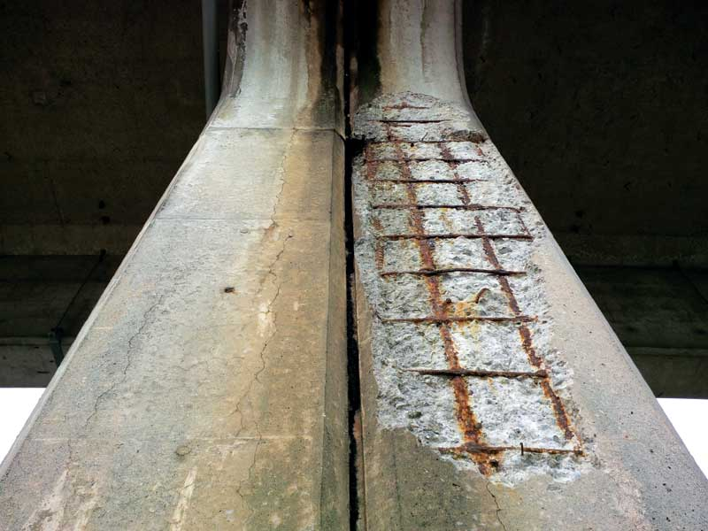
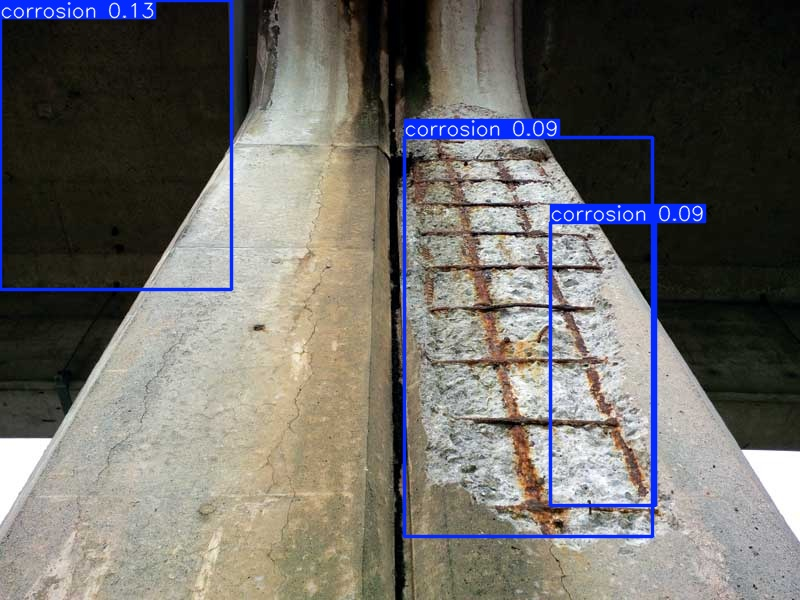
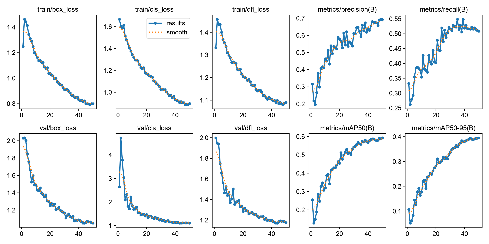
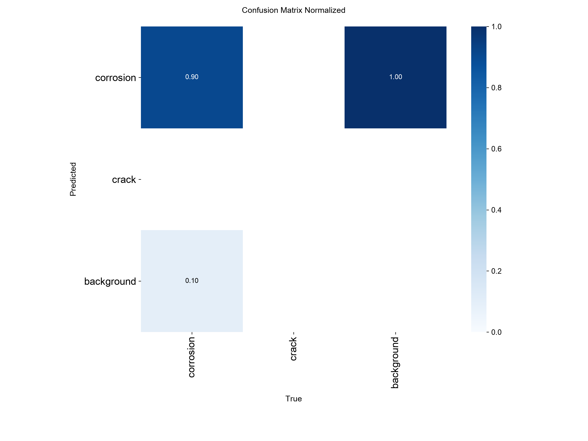
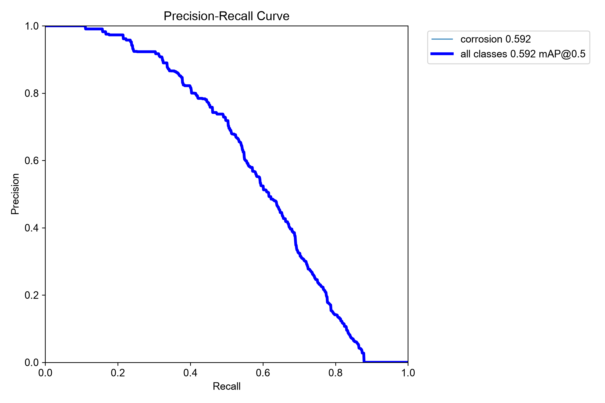
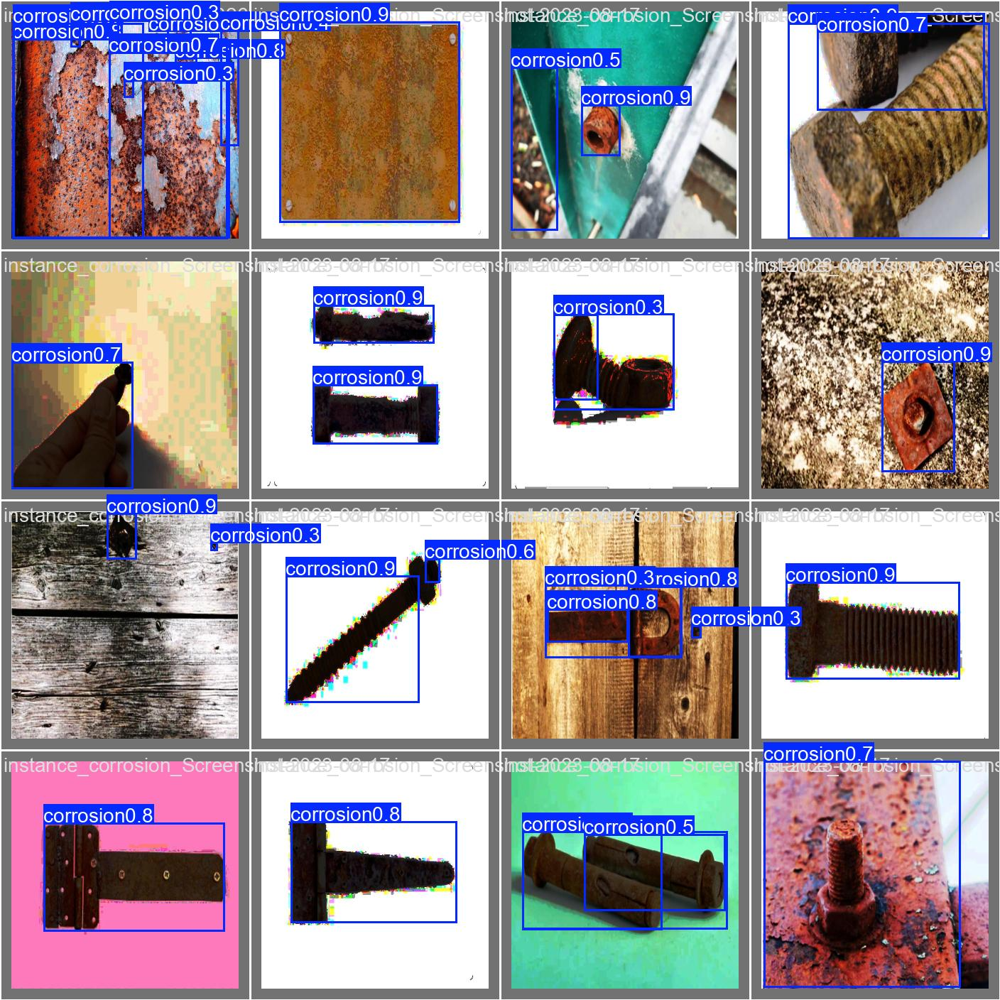

# Automated Corrosion and Structural Defect Detection with YOLO11

A deep learning framework for automated visual inspection and Structural Health Monitoring (SHM) of civil infrastructure, bridges, and industrial steel assets using the state-of-the-art YOLO11 architecture.

---

## Visual Demonstration

The model identifies and localizes surface rust, structural corrosion, and concrete deterioration on bridge infrastructure with high precision and bounding box fidelity.

| Original Infrastructure Input | Model Inference Output |
| :---: | :---: |
|  |  |

*Figure 1: Side-by-side demonstration of structural corrosion detection on bridge reinforcement girders using the trained YOLO11m weights.*

---

## Executive Summary

Corrosion and structural degradation represent catastrophic risks to civil infrastructure worldwide, including bridges, offshore platforms, pipelines, and industrial facilities. Manual inspection is hazardous, time-consuming, subjective, and difficult to scale across thousands of infrastructure miles.

This repository provides an end-to-end computer vision pipeline tailored for:
* Multi-source corrosion dataset aggregation and standardization.
* Unified taxonomy harmonization across disparate academic and industrial defect categories.
* Training and fine-tuning Ultralytics YOLO11m models across both local Apple Silicon (MPS acceleration) and distributed cloud environments (CUDA on Google Colab).
* Robust bounding-box detection of active corrosion, structural degradation, exposed reinforcement bars, and cracking.

---

## Model Architecture and Specifications

The detection backbone employs Ultralytics YOLO11m (Medium variant), balancing real-time inference latency with dense feature representation necessary for fine-grained defect identification.

### Architectural Highlights
* **Backbone**: Modified CSPDarknet with C3k2 blocks and Spatial Pyramid Pooling Fast (SPPF) module to aggregate multi-scale contextual features.
* **Neck**: Path Aggregation Network (PAN) with Feature Pyramid Network (FPN) integration for bidirectional cross-scale feature propagation.
* **Head**: Decoupled, anchor-free detection head optimizing task-aligned bounding-box regression and classification independently.
* **Loss Functions**: Complete IoU (CIoU) / Distribution Focal Loss (DFL) for box regression combined with Binary Cross-Entropy (BCE) for class probability.

### Training Configuration

| Parameter | Value | Description |
| :--- | :--- | :--- |
| Model Variant | `yolo11m.pt` | Medium scale YOLO11 pretrained checkpoint |
| Task | Object Detection (`detect`) | Anchor-free bounding-box prediction |
| Input Resolution | 320 x 320 (Local) / 640 x 640 (Cloud) | Scalable multi-scale inference |
| Batch Size | 16 | Optimized for memory footprint and gradient stability |
| Epochs | 50 | Full convergence schedule |
| Optimizer | Auto (AdamW / SGD) | Cosine learning rate decay with momentum |
| Initial Learning Rate (`lr0`) | 0.01 | With warmup over 3 epochs |
| Final Learning Rate Factor (`lrf`) | 0.01 | Cosine annealing target multiplier |
| Weight Decay | 0.0005 | L2 regularization |
| Momentum | 0.937 | First-order gradient momentum |
| Hardware Accelerator | Apple Silicon MPS (`mps`) / NVIDIA CUDA | Hardware-native tensor cores |
| Total Training Duration | 9,461 seconds (~2.6 hours) | 50 complete passes on MPS |

---

## Benchmark Performance and Quantitative Metrics

The trained model converged stably over 50 epochs on the unified multi-source dataset, showing significant gains in precision, recall, and mean Average Precision (mAP).

### Summary Table

| Metric | Score | Note |
| :--- | :--- | :--- |
| **Precision (B)** | **69.15%** (0.69145) | High positive predictive value, minimizing false positives |
| **Recall (B)** | **50.89%** (0.50893) | Comprehensive capture of corroded regions |
| **mAP@0.50** | **59.22%** (0.59222) | Robust detection at standard overlap threshold |
| **mAP@0.50:0.95** | **39.51%** (0.39506) | Strict multi-threshold spatial accuracy |
| **Box Loss (Train / Val)** | 0.7998 / 1.0501 | Smooth convergence with minimal overfitting |
| **Class Loss (Train / Val)** | 0.8972 / 1.1054 | Consistent target discrimination |

### Epoch Convergence Progression

| Epoch | Train Box Loss | Train Cls Loss | Precision | Recall | mAP@0.50 | mAP@0.50:0.95 |
| :---: | :---: | :---: | :---: | :---: | :---: | :---: |
| 1 | 1.2477 | 1.6671 | 0.3153 | 0.3319 | 0.2557 | 0.1069 |
| 10 | 1.1833 | 1.3444 | 0.4632 | 0.3542 | 0.3204 | 0.1778 |
| 20 | 1.0353 | 1.1711 | 0.5775 | 0.4018 | 0.4544 | 0.2822 |
| 30 | 0.9116 | 1.0270 | 0.6098 | 0.5164 | 0.5422 | 0.3374 |
| 40 | 0.8307 | 0.9350 | 0.6390 | 0.5189 | 0.5682 | 0.3812 |
| 50 | 0.7998 | 0.8972 | 0.6915 | 0.5089 | 0.5922 | 0.3951 |

---

## Visualizations and Diagnostic Curves

### Training Loss and Performance Trajectory
The following curves illustrate loss reduction and metric ascension across bounding box, classification, and distribution focal loss objectives.



*Figure 2: Loss trajectories and metric progression (Precision, Recall, mAP50, mAP50-95) across 50 training epochs.*

### Normalized Confusion Matrix
The confusion matrix demonstrates strong class boundary resolution between structural defects and background regions.



*Figure 3: Normalized confusion matrix demonstrating defect classification fidelity against background noise.*

### Precision-Recall Dynamics
The Precision-Recall curve reflects consistent confidence thresholds across all defect instances.



*Figure 4: Precision-Recall curves evaluating detector trade-offs across IoU thresholds.*

### Validation Batch Predictions
Sample predictions generated on unseen validation images during the final evaluation phase.



*Figure 5: Model predictions on validation image batches demonstrating multi-scale bounding box delineation.*

---

## Dataset Architecture and Details

A primary contribution of this project is the synthesis and standardization of multiple heterogenous corrosion datasets into a unified, machine-actionable schema.

### 1. Benchmark Datasets Integrated

The ingestion pipeline (`download_datasets.py` and `Colab_YOLO11_Training.py`) interfaces with Roboflow Universe and Zenodo open-access archives:

| Dataset Identifier | Source / Workspace | Version | Description and Scope |
| :--- | :--- | :---: | :--- |
| **Instance Corrosion** | `cawilcorrosionsegmentation/instance-corrosion` | 2 | Instance-level annotations for surface oxidation, severe rust, and concrete discoloration. |
| **Corrosion Detection Large** | `yatishs-workspace/corrosion-detection-z8iw3` | 1 | Extensive real-world industrial dataset covering civil infrastructure and metallic assets. |
| **ThyssenKrupp Steel** | `thyssenkrupp/corrosion-whmsc` | 1 | Industrial steel degradation, surface pits, and structural beam rust. |
| **University Steel Corrosion** | `university-of-tebessa/corrosion-eh3ms` | 1 | Academic dataset documenting corrosion kinetics and defect morphologies on metals. |
| **Large Corrosion Detection** | `corrosion-l4cqs/corrosion-detection-npdhd` | 4 | High-resolution field captures of industrial plant and structural framing corrosion. |
| **Multi-Type Corrosion** | `identification-pittin-corrosion/corrosion-segmentation-rsfbe` | 1 | Morphological categorization including pitting, uniform, and galvanic corrosion. |
| **Corrosion Types 4-Class** | `godson-0hjq0/corrosion-detection-0pt6o` | 1 | Graded severity classifications (mild, moderate, severe oxidation). |
| **Scaledge Corrosion** | `scaledge-ztihl/corrosion-detection-obirw` | 1 | Specialized edge corrosion, weld deterioration, and joint oxidation. |
| **Drima Corrosion** | `drima/corrosion-zjnrh` | 1 | Industrial equipment and pipe rust defect annotations. |
| **CODEBRIM** | Zenodo (doi:10.5281/zenodo.2620293) | 1 | High-resolution bridge inspection benchmark covering concrete defect classes (corrosion, exposed rebar, spalling, cracks). |

### 2. Taxonomy and Class Harmonization

Different datasets employ conflicting nomenclatures and label granularities. The preprocessing engine (`merge_datasets.py`) provides two formal mapping standards:

#### A. Standardized 2-Class Taxonomy (Baseline Run)
Optimized for high-confidence binary screening of infrastructure integrity:
* `Class 0 (corrosion)`: Aggregates surface rust, rebar rust, pitting corrosion, uniform corrosion, and oxidation staining.
* `Class 1 (crack)`: Structural fissures, concrete cracking, and fracture lines.

#### B. Extended 4-Class Bridge Health Taxonomy (`train_corrosion_yolo11.py`)
Specialized for comprehensive Bridge Inspection Reports following structural engineering standards:
* `Class 0 (rebar_corrosion)`: Rust staining coupled with spalling originating from internal reinforcement steel oxidation.
* `Class 1 (steel_corrosion)`: Oxidation on structural steel beams, girders, gusset plates, rivets, and flange assemblies.
* `Class 2 (rust_stain)`: Early-stage brown and orange chemical leaching visible on concrete surface facades.
* `Class 3 (exposed_rebar)`: Reinforcement bars physically uncovered due to delamination and concrete cover failure.

### 3. Data Augmentation and Preprocessing Pipeline

To maximize generalization under varying atmospheric conditions, camera angles, and illumination levels, the training pipeline applies:
* **Spatial Transforms**: Random affine transformations, shear (+/- 2.0 degrees), horizontal flip (p=0.5), vertical flip (p=0.5), and translation (+/- 10%).
* **Mosaic Augmentation**: Mosaic mixing ratio set to 0.5, disabled in the final 5 epochs (`close_mosaic: 5`) to prevent feature distortion during final convergence.
* **Photometric Distortions**: HSV color jitter (Hue: 0.015, Saturation: 0.7, Value: 0.4) to simulate sunlight, shadow, and overcast weather.
* **Random Erasing**: Applied with probability 0.4 to simulate partial occlusion by grime, watermarks, and vegetation.

---

## Directory Structure

```text
Corrosion/
├── .gitignore                                     # Clean exclusions (ignores raw archives and intermediate checkpoints)
├── Bridge-Corrosion.jpg                           # Sample input bridge asset image
├── test_result.jpg                                # Detection visualization output
├── COLAB_README.md                                # Google Colab multi-GPU execution guide
├── Colab_YOLO11_Training.py                       # Self-contained Colab notebook script
├── Corrosion_Bridge_Detection_YOLO11.ipynb        # Interactive Jupyter notebook for bridge defect training
├── Corrosion_Bridge_YOLO11_M5_Mac.ipynb           # Apple Silicon M-series optimized notebook
├── Corrosion_YOLO11_Training.ipynb                # General training walkthrough notebook
├── download_datasets.py                           # Multi-source dataset downloader (Roboflow API)
├── merge_datasets.py                              # Dataset harmonization, class mapping, and YOLO formatting
├── merge_datasets_quick.py                        # Rapid dataset aggregation utility
├── monitor_training.sh                            # Shell script for real-time background training monitoring
├── start_training.py                              # Daemon launcher for persistent training jobs
├── train_corrosion_yolo11.py                      # Resumable 4-class bridge inspection trainer
├── train_with_logging.py                          # Training wrapper with structured stdout logging
├── train_yolo11m.py                               # Core Apple Silicon MPS training execution script
├── training.log                                   # Complete console execution and epoch log
├── yolo11m.pt                                     # Official Ultralytics base pretrained model (39 MB)
└── training_results/
    └── runs/
        └── yolo11m_corrosion/
            ├── args.yaml                          # Full hyperparameter configuration record
            ├── results.csv                        # Raw tabular metrics recorded per epoch
            ├── results.png                        # Composite loss and mAP curves
            ├── confusion_matrix.png               # Absolute confusion matrix
            ├── confusion_matrix_normalized.png    # Normalized confusion matrix
            ├── BoxPR_curve.png                    # Precision-Recall curve
            ├── BoxF1_curve.png                    # F1-confidence curve
            ├── BoxP_curve.png                     # Precision-confidence curve
            ├── BoxR_curve.png                     # Recall-confidence curve
            ├── val_batch0_labels.jpg              # Ground truth labels batch 0
            ├── val_batch0_pred.jpg                # Model predictions batch 0
            └── weights/
                ├── best.pt                        # Highest mAP50 model checkpoint (39 MB)
                └── last.pt                        # Final epoch state model checkpoint (39 MB)
```

---

## Installation and Environment Setup

### Prerequisites
* Python 3.10 or higher
* PyTorch 2.1+ with MPS (macOS) or CUDA (Linux/Windows) support
* macOS 13+ with Apple Silicon or Ubuntu 20.04+ with NVIDIA GPU

### Step 1: Clone Repository
```bash
git clone https://github.com/gabsgj/SID-Corrosion-Depreciated.git
cd SID-Corrosion-Depreciated
```

### Step 2: Create and Activate Virtual Environment
```bash
python3 -m venv venv_yolo
source venv_yolo/bin/activate
```

### Step 3: Install Required Dependencies
```bash
pip install --upgrade pip
pip install ultralytics torch torchvision torchaudio opencv-python pillow pyyaml tqdm roboflow
```

---

## Usage Guide

### 1. Running Inference with Pretrained Weights

Use the saved `best.pt` model weights to detect corrosion on images, directories, or video streams.

#### Via Command Line:
```bash
yolo task=detect mode=predict \
    model=training_results/runs/yolo11m_corrosion/weights/best.pt \
    source=Bridge-Corrosion.jpg \
    conf=0.25 \
    save=True
```

#### Via Python API:
```python
from ultralytics import YOLO
import cv2

# Load the trained model
model = YOLO('training_results/runs/yolo11m_corrosion/weights/best.pt')

# Run inference
results = model.predict(
    source='Bridge-Corrosion.jpg',
    conf=0.30,
    iou=0.70,
    imgsz=640,
    save=True,
    device='mps'  # or 'cuda', 'cpu'
)

# Process detections
for result in results:
    boxes = result.boxes
    for box in boxes:
        cls_id = int(box.cls[0])
        class_name = model.names[cls_id]
        confidence = float(box.conf[0])
        coords = box.xyxy[0].tolist()
        print(f"Detected: {class_name} ({confidence:.2f}) at coordinates {coords}")
```

### 2. Dataset Download and Merging

To download datasets from Roboflow and compile them into a unified folder:

```bash
# Set your Roboflow API Key inside download_datasets.py
python3 download_datasets.py

# Standardize annotations and merge splits
python3 merge_datasets.py
```

### 3. Training on Apple Silicon (MPS)

Launch local training with built-in Apple Silicon optimizations:

```bash
python3 train_yolo11m.py
```

To run in the background with continuous logging:
```bash
python3 start_training.py
tail -f training.log
```

### 4. Training on Google Colab (CUDA)

For training on larger datasets (27,000+ images) with Tesla T4 or A100 GPUs:
1. Open [Google Colab](https://colab.research.google.com).
2. Upload `Colab_YOLO11_Training.py` or `Corrosion_Bridge_Detection_YOLO11.ipynb`.
3. Configure your `ROBOFLOW_API_KEY`.
4. Select GPU runtime (`Runtime -> Change runtime type -> T4 GPU`).
5. Execute all cells; checkpoints will save directly to connected Google Drive storage.

---

## Technical Notes and Considerations

* **Git File Size Management**: Large raw archives (`roboflow.zip` ~1.1GB, `CODEBRIM.zip` ~260MB) and intermediate optimizer checkpoints (`epoch*.pt` ~1.5GB) are excluded via `.gitignore` to comply with GitHub remote repository limits. The optimal weights (`best.pt` and `last.pt` at 39MB each) remain fully tracked and instantly deployable.
* **Apple Silicon Memory Management**: On unified memory configurations (e.g. 16GB / 32GB), setting `imgsz: 320` and `batch: 16` provides optimal throughput without triggering swap thrashing. For high-resolution 640px training, batch size should be reduced to 8 or executed on dedicated GPU hardware.

---

## References and Citations

1. Jocher, G., Chaurasia, A., & Qiu, J. (2024). *Ultralytics YOLO11*. https://github.com/ultralytics/ultralytics
2. Mundt, M., Majumder, S., Murali, S., Kohlhammer, P., & Ramesh, V. (2019). *CODEBRIM: Concrete Defect Bridge Image Dataset*. Zenodo. https://doi.org/10.5281/zenodo.2620293
3. Roboflow Universe Open-Source Datasets. https://universe.roboflow.com/
